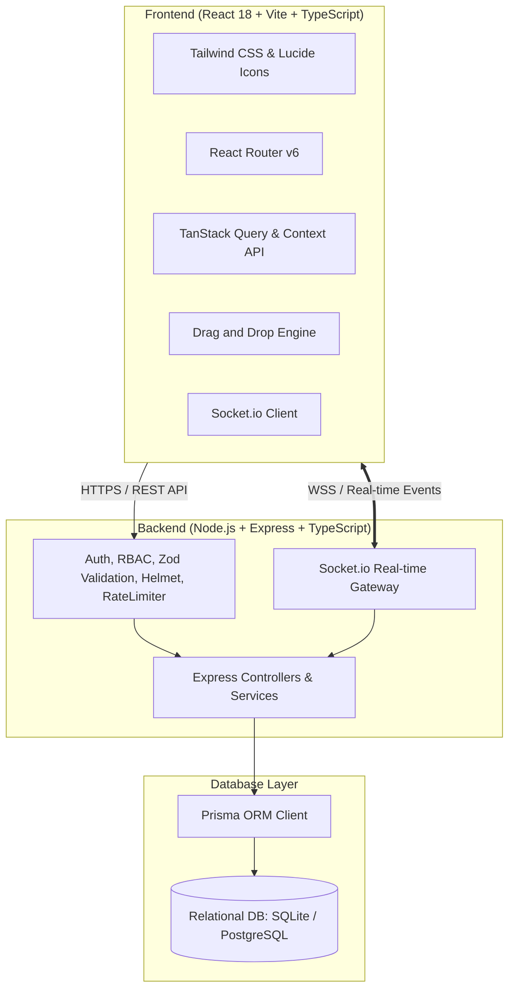

# ⚡ FLOWBOARD — Collaborative Project Management Platform

> A production-grade, full-stack collaborative project management platform built for modern engineering teams. Featuring real-time Kanban workspaces, role-based authorization (RBAC), drag-and-drop task pipelines, activity audit logs, interactive comments, and dark/light modes.

🌐 **Live Demo (Frontend)**: [https://frontend-five-jet-81.vercel.app](https://frontend-five-jet-81.vercel.app)  
🔌 **Live API & WebSocket (Backend)**: [https://flowboard-backend-ao1v.onrender.com](https://flowboard-backend-ao1v.onrender.com)

[](https://www.typescriptlang.org/)
[](https://reactjs.org/)
[](https://nodejs.org/)
[](https://www.prisma.io/)
[](https://socket.io/)
[](https://tailwindcss.com/)

---

## 🌟 Key Features

- 📋 **Interactive Kanban Board**: Fluid drag-and-drop task movement between columns and reordering with optimistic local UI updates and instant Socket.io peer broadcast.
- 🔐 **Authentication & RBAC**: JWT-based stateless authentication with secure bcrypt password hashing and 3-tier role hierarchy (`OWNER` > `ADMIN` > `MEMBER`).
- 📊 **Executive Portfolio Dashboard**: Real-time aggregated metrics across all projects (active tasks, completion velocity, overdue tasks, team members, and recent activity audit timeline).
- 🏷️ **Comprehensive Task Cards**: Priority badges (`LOW`, `MEDIUM`, `HIGH`, `URGENT`), custom-colored project labels, formatted due dates with overdue alerts, multi-assignee avatar stacks, and comment counters.
- 💬 **Interactive Comments & Audit Trail**: Real-time comment threads with instant broadcast and automated activity history logging (tracking card movements, creations, updates, assignments).
- 👥 **Team & Member Management**: Email-based project invitations, custom member roles, and permission gates.
- 🌓 **Dark / Light Theme Engine**: Persistent theme switcher with system preference detection and CSS variable tokens.
- 📱 **Fully Responsive**: Adapts seamlessly from 4K desktop displays to mobile devices with collapsible navigation drawers.

---

## 🏗️ Architecture & Technology Stack



| Layer | Technologies |
| :--- | :--- |
| **Frontend** | React 18, TypeScript, Vite, Tailwind CSS, React Router v6, TanStack Query, React Hook Form, Zod, Lucide Icons, Date-fns, Canvas-Confetti |
| **Backend** | Node.js, Express.js, TypeScript, Prisma ORM, Socket.io, JSON Web Tokens (JWT), bcryptjs, Helmet, CORS, Express Rate Limit, Morgan |
| **Database** | PostgreSQL / SQLite with Prisma ORM migrations & relational schema |
| **Testing** | Vitest, Supertest (100% passing automated test suite) |

---

## 🗄️ Database Schema & Data Models

- **User**: Authentication, profile credentials, avatar, bio.
- **Project**: Workspace name, description, unique key prefix (e.g., `FLOW`), owner relation.
- **ProjectMember**: Unique compound index `[projectId, userId]` with role (`OWNER` | `ADMIN` | `MEMBER`).
- **Column**: Board columns with order index and project relationship.
- **Task**: Card title, description, priority, due date, order index, creator, archive state.
- **TaskAssignee**: Multi-user task assignments (`[taskId, userId]`).
- **Label & TaskLabel**: Project-level custom color labels attached to tasks.
- **Comment**: Task comment thread with author user metadata.
- **Activity**: Comprehensive project and task audit trail events (`PROJECT_CREATED`, `TASK_CREATED`, `TASK_MOVED`, `COMMENT_ADDED`, etc.).

---

## 🚀 Quick Start Guide

### Prerequisites
- **Node.js**: v18.0.0 or later
- **npm**: v9.0.0 or later

### 1. Clone & Install Dependencies

```bash
# Install backend dependencies
cd backend
npm install

# Install frontend dependencies
cd ../frontend
npm install
```

### 2. Setup Database & Seed Demo Data

```bash
cd backend
# Push schema to database
npx prisma db push

# Seed rich demo data (4 users, 2 projects, tasks, comments, activities)
npm run db:seed
```

### 3. Run Development Servers

You can start the backend and frontend independently:

```bash
# Terminal 1: Backend Server (Port 5000)
cd backend
npm run dev

# Terminal 2: Frontend Client (Port 5173)
cd frontend
npm run dev
```

Open your browser at: **`http://localhost:5173`**

---

## 🔑 Pre-Configured Demo Credentials

The database seed includes pre-configured accounts (Password for all: `Password123!`):

| User | Email | Role / Position |
| :--- | :--- | :--- |
| **Alex Rivera** | `alex@flowboard.dev` | Project Owner / Tech Lead |
| **Sarah Chen** | `sarah@flowboard.dev` | Frontend Lead / Admin |
| **Marcus Johnson** | `marcus@flowboard.dev` | Backend Engineer / Member |
| **Elena Rostova** | `elena@flowboard.dev` | UI/UX Designer / Member |

*Note: The login page includes convenient **1-Click Demo Buttons** for instant evaluation.*

---

## 🧪 Testing & Verification

Run the automated test suite covering Authentication, RBAC gates, Project lifecycle, Drag-and-Drop, and Comment operations:

```bash
cd backend
npm run test
```

Type checking:
```bash
# Backend TypeScript Check
cd backend && npx tsc --noEmit

# Frontend TypeScript Check
cd frontend && npx tsc --noEmit
```

Production builds:
```bash
# Frontend production bundle
cd frontend && npm run build

# Backend compilation
cd backend && npm run build
```

---

## 🔌 Real-Time Socket.io Events

| Event Name | Direction | Payload Description |
| :--- | :--- | :--- |
| `join_project` | Client $\rightarrow$ Server | Subscribes socket to `project:${projectId}` room |
| `leave_project` | Client $\rightarrow$ Server | Unsubscribes socket from project room |
| `task:created` | Server $\rightarrow$ Client | Broadcasts newly created task card to room members |
| `task:updated` | Server $\rightarrow$ Client | Broadcasts title, description, priority, or assignee updates |
| `task:moved` | Server $\rightarrow$ Client | Real-time card movement and order index synchronization |
| `task:deleted` | Server $\rightarrow$ Client | Notifies room of card removal |
| `comment:added` | Server $\rightarrow$ Client | Broadcasts new comments in real time |
| `activity:logged` | Server $\rightarrow$ Client | Appends new audit trail item to project activity stream |

---

## 🛡️ Security & Quality Standards

- **Password Hashing**: Secure salted hashes via `bcryptjs`.
- **JWT Protection**: Stateless bearer tokens verified on protected API routes.
- **Server-Side RBAC**: Every project modification is authorized on the backend.
- **Input Validation**: Strict request payload schema validation using Zod on both client and server.
- **Rate Limiting**: Brute-force protection on authentication endpoints.
- **Security Headers**: Express `helmet` integration and strict CORS policy.
- **No Secrets in Repo**: All secrets managed through environment variables (`.env.example` provided).

---

## 📄 License
MIT License. Built for Full Stack Development Internship Evaluation and Portfolio Showcase.
